# Betterway Mortgages — Forensic PDF & Asset Analysis, UAE Competitor Intelligence & Best Mortgage OS Benchmark

> **Prepared For:** Executive Leadership, Betterway Mortgages LLC (`Al Nasr Plaza, Plot 319-310, Oud Metha Road, Dubai, UAE` · Sister Venture to SWK Properties LLC)  
> **Repository Audited:** `https://github.com/swkpropertiesuae/BETTERWAYMORTGAGES` (`main` & `claude/*` branches) + Local Brokerage Vaults (`D:\02_Brokerage_Operations_SWK_and_Betterway\`) + `SWKOS` v3.8.0 & `SWK_MOBILE` v3.0.0  
> **Audit Date:** 25 November 2026

---

## Executive Summary

1. **Two Distinct Visual Eras Identified in the Repo — Unified Around the Nov 24, 2026 Master Identity:** Deep forensic extraction of `BETTERWAYMORTGAGES` (`origin/main`) revealed **10 vector PDFs** led by `Betterway_Mortgages_Brand_Identity_Sheet.pdf` (created 24 Nov 2026) alongside the earlier Sovereign Gold & Editorial Serif kit. The newest Master Brand Identity establishes a **sculpted lowercase `b` + house brandmark** with **Emerald Ribbon** (`#34DFAC` → `#179373` → `#0A4A3E`) flowing into **Champagne Gold** (`#FCF1B7` → `#D7B158` → `#BA8D36`) over **Midnight Navy** (`#070E1A` / `#0C1524`) and **Pure White** (`#FFFFFF`), paired with **Montserrat Bold** (`betterway` lowercase `-0.012em` + `MORTGAGES` uppercase `+0.275em`). The repo also ships **24 official UAE bank logos**, **6 staff 8K studio portraits**, **58 architectural & 8K morning Dubai images**, **7 developer project renders**, **5 videos**, and live **CBUAE EIBOR / 60-community / 10-calculator deterministic finance modules**.
2. **Operational PDFs Specify an Institutional 20-Module / 12-Milestone / 50-Excel Mortgage OS:** Auditing `Betterway_Mortgages_OS_Requirements.pdf` (16 pages), `Mortgage presentation-Landscape.pdf` (10 pages), `Betterway Forensic Underwriting & Client Advisory Dossier (38 Units).pdf` (17 pages), and `Betterway_UAE_Mortgage_30_Clients_2Page_Closing_Dossiers.pdf` (62 pages, AED 298.28M target loan pool / AED 2.36M DSA fee / AED 7.90M with SWK relay) provides exact underwriting rules (Salaried AED 10k min, Self-Employed Full-Doc AED 2M turnover / 2yr trade licence vs Low-Doc AED 40k personal credits & AED 15k min balance, Non-Resident AED 40k / 4 txns / AED 15k min / AED 25k avg up to AED 2.2M, Age caps 65 salaried / 70 self-employed) and all 50 Excel governance specifications.
3. **UAE Market Forensics (15+ Competitors Mapped):** The UAE mortgage market is bifurcated between venture-funded PropTech super-apps (**Huspy** ~$106M+ raised / ~25–30% share, **Holo** $22M Series A, **PRYPCO** AED 20B+ cumulative), portal/agency captives (**Mortgage Finder**, **Allsopp & Allsopp**, **Betterhomes**, **haus & haus**), agile digital/boutique brokers (**Lenddoo**, **Home Matters**, **Capital Zone**, **Money Maestro**, **Mortgage Market**, **Finance Lab**), and direct bank portals (**ENBD**, **FAB**, **ADCB**, **Mashreq**, **DIB**, **ADIB**, **HSBC**). Every competitor has a clear blind spot — and **Betterway × SWK Properties** holds an unmatched structural wedge: **Dual-Relay Economics** (capturing both 2% real estate brokerage + 0.50%–1.00% bank DSA mortgage commission on DLD-verified handover/resale inventory) + **Low-Doc/Self-Employed/Non-Resident underwriting depth** + **CBUAE-transparent zero-bloat tech**.
4. **Best Mortgage OS Verdict:** After benchmarking 9 global leaders (**ARIVE**, **nCino SimpleNexus**, **ICE Encompass**, **Floify**, **Finmo**, **Acre**, **Blend**, **Shape CRM**, **Jungo/Salesforce FSC**, **LendingPad**) against **SWK Properties OS v3.8.0**, no off-the-shelf US/UK SaaS supports UAE CBUAE DBR/LTV rules, EIBOR revert floors, DLD/ADREC/Oqood handover workflows, Islamic Ijara/Murabaha terminology, MOHRE WPS, UAE PDPL, goAML, bilingual EN/AR RTL, or SWK sister-brokerage attribution. **The winning architecture is a purpose-built Betterway Mortgage OS modeled directly on SWK Properties OS v3.8.0 (Express + built-in SQLite + React 19 + Vite + Tailwind + Motion + 21st.dev surfaces) combined with a 3-Sided PWA + Capacitor Mobile App (Advisor + Borrower + RERA Partner modes modeled on SWK Mobile v3.0.0 & nCino SimpleNexus).**

---

## Part 1 — Deep Forensic Audit of All Betterway PDFs & Repository Assets

### 1.1 Master Brand Identity PDF (`Betterway_Mortgages_Brand_Identity_Sheet.pdf`)

Located in `https://github.com/swkpropertiesuae/BETTERWAYMORTGAGES` (`main` branch) at `public/brand/raw/06_Brand_Identity_Presentation/Betterway_Mortgages_Brand_Identity_Sheet.pdf` (1 page, 1440×810 pt vector master, generated 24 Nov 2026) alongside 9 pure-vector print PDFs (`01_Primary_Logo_Horizontal` through `04_Wordmark_Letter`) and `brand-tokens.json`.

#### Exact Forensic Design Token Table (Extracted from `brand-tokens.json` & PDF Vectors)

| Token Name | Hex | RGB | CMYK | Mandatory OS & Mobile Application |
| :--- | :--- | :--- | :--- | :--- |
| **Midnight Navy** | `#070E1A` | `7, 14, 26` | `92, 78, 52, 74` | Primary dark canvas, splash screen, executive hero cards, mobile dark chrome |
| **Navy Surface** | `#0C1524` | `12, 21, 36` | `90, 75, 48, 66` | Elevated dark panels, Core Suite cards, sidebar rail, glass modals |
| **Emerald Light** | `#34DFAC` | `52, 223, 172` | `68, 0, 44, 0` | Ribbon highlight, live sync pulse, active approval badges, chart accents |
| **Emerald Mid** | `#179373` | `23, 147, 115` | `85, 18, 64, 5` | Primary action CTA buttons, active nav pills, verified status chips |
| **Emerald Deep** | `#0A4A3E` | `10, 74, 62` | `92, 42, 68, 42` | Deep emerald gradient anchor, Betterway Inside card backdrop |
| **Gold Gleam** | `#FCF1B7` | `252, 241, 183` | `2, 3, 32, 0` | Metallic foil specular highlight, splash starburst particles |
| **Gold Mid** | `#D7B158` | `215, 177, 88` | `16, 28, 76, 2` | `MORTGAGES` wordmark gradient midtone, VIP/Owner badges, pointer spotlight |
| **Gold Rich** | `#BA8D36` | `186, 141, 54` | `24, 42, 92, 10` | Gold rules, seal frames, light-surface readable gold text accents |
| **Pure White** | `#FFFFFF` | `255, 255, 255` | `0, 0, 0, 0` | Light-surface floating cards, daylight header, print KFS documents |

- **Typography Rules:** `Montserrat Bold` (700) for brand wordmark (`betterway` lowercase tracking `-0.012em`, `MORTGAGES` uppercase tracking `+0.275em`), paired with `Plus Jakarta Sans` / `Inter` for clean UI & tabular numerals, `Instrument Serif Italic` for editorial accents, `JetBrains Mono` for AED/EIBOR/LTV/DBR figures, and `IBM Plex Sans Arabic` / `Noto Sans Arabic` for full RTL Arabic mode.
- **Optical & Usage Rules:** Minimum clear space = `0.25×` brandmark bowl diameter on all sides; minimum digital horizontal width `140px`, minimum icon `16px`. Outlined SVGs (`SVG_Outlined/`) are pure Bézier curves requiring zero external fonts.
- **Brand Continuity vs. Earlier Kit (`brand-identity-board.png`):** The repository also retains the earlier Sovereign Gold & Editorial Serif kit (`#021125` + `#D7B04E` 45° gable squircle house) in `public/brand/kit/`. In the new OS & Mobile App, the **Nov 24, 2026 Emerald Ribbon + Champagne Gold `b`-house Raw Brand Pack** serves as the **Master Visual Identity**, while maintaining crisp light-surface (`betterway-logo-horizontal-light-bg.svg`) and dark-surface (`betterway-logo-horizontal-dark-bg.svg`) pairing everywhere.

### 1.2 Operational & Underwriting PDFs Audited (`D:\02_Brokerage_Operations_SWK_and_Betterway\`)

| PDF Document | Pages / Size | Key Operational Rules & Data Extracted |
| :--- | :--- | :--- |
| **`Betterway_Mortgages_OS_Requirements.pdf`** | 16 pp · Nov 2026 | Defines **20 Feature Areas** (12 Launch, 6 Phase 2, 2 Conditional), **12 Case Milestones** (`01 New Enquiry` → `12 Close/Service`), **9 Mortgage/Advisory Scenarios**, and **50 Excel File Specifications** (`35` Launch Setup/Migration/Export/Test + `10` Phase 2 + `5` Conditional). Mandates versioned rate ownership, scoped document vaults, finance approval before payouts, and full audit trails. |
| **`Mortgage presentation-Landscape.pdf`** | 10 pp | Documents Betterway's **15-year UAE underwriting playbook**: (1) **Salaried Residents**: min AED 10,000/mo continuous 6-mo salary transfer, 80% 1st property / 60% subsequent, max age 65; (2) **Self-Employed Full-Doc**: 2yr trade license, 1yr ownership, AED 2M 12-mo corporate turnover, max age 70; (3) **Self-Employed Low-Doc**: AED 40k/mo personal deposits & AED 15k min balance, 50–60% LTV, max AED 2M loan, 4-quarter VAT returns + Ejari + AECB + AED 1,050 pre-approval cheque; (4) **Non-Residents**: AED 40k/mo in 4 txns, AED 15k month-end / AED 25k avg balance, up to AED 2.2M, no equity release; (5) **Joint Eligibility**: spouse or blood-relation income stacking where primary qualifies; (6) **Rental Income**: recognized when ≥ AED 600k/yr; (7) **5 Core Product Flows**: Handover Payment (SOA balance), Resale (up to 80%), Equity Refinance (50–70%), Buy-Out, Buy-Out + Equity. |
| **`Betterway_UAE_Mortgage_30_Clients_2Page_Closing_Dossiers.pdf`** | 62 pp · 20 Nov 2026 | Live commercial proof of **Betterway × SWK Properties Dual-Relay**: 30 verified DLD Title/Oqood mortgage leads representing **AED 298,283,563** target loans, **AED 2,360,501** direct bank DSA commission, and **AED 7,902,861** combined SWK+Betterway relay revenue (DED `#1084921`, RERA ORN `#31910`, CBUAE `#CBUAE-MB-2025-041`). |
| **`Betterway Forensic Underwriting & Client Advisory Dossier (38 Units).pdf`** | 17 pp · 18 Nov 2026 | 38 resolved Dubai inventories (JVC, DAMAC Lagoons, Arabian Ranches 3, Town Square, Villanova, Mudon, Expo City, Terrazzo Bldg B) modeled at CBUAE 80% LTV, 3.89% fixed / 25-yr (`AED 5,218` per AED 1M financed), DLD Circular 02-2026 & UAE PDPL Law 45/2021 compliant. |

### 1.3 Complete Asset Inventory Mapped to the New OS & Mobile App

Every verified asset from `BETTERWAYMORTGAGES/public/` is systematically deployed:
- **Brand Identity Suite (`public/brand/raw/` + favicons):** Horizontal dark/light/mono-gold SVGs in topbar, sidebar, print KFS headers, and mobile headers; Stacked dark/light SVGs on login, splash, and client portal; Full-color `b`-house icon (`512px`/`1024px` squircles) as PWA & Capacitor Android/iOS launcher icons and favicon suite.
- **24 Official UAE Bank Logos (`public/banks/`):** ENBD, FAB, ADCB, DIB, ADIB, Emirates Islamic, Mashreq, HSBC, Standard Chartered, CBD, RAKBANK, RAKislamic, SIB, UAB, Ajman Bank, Al Hilal, NBF, NBQ, Arab Bank, Citi, Bank of Baroda, Invest Bank, CBI, Amlak Finance — deployed across the 24-Bank Rate Desk, Multi-Bank Submission Tracker, Quote Comparison Cards, and Mobile Bank Panel.
- **6 Staff 8K Studio Portraits (`public/staff/` & `public/staff/8k/`):** Daniel Xavier (Team Manager & Mortgage Advisor), Asif Khan (Mortgage Advisor), Reshma Rajan (Telesales cum Mortgage Advisor), Elton Frank (Coordinator / Progression), Mohammad Nusrik (Digital Marketing), Rahaba Azeez (HR Manager) + Executive profiles Shabib Siraj (Founder & MD), Warda (Executive Director), and Betterway Admin — deployed across Topbar profile, Team Directory, Advisor Leaderboard, Case Owner Chips, Attendance Live Feed, and Mobile Account views.
- **58 Dubai Architectural & Guide Photos + 7 Developer Renders + 5 Videos (`public/images/`, `public/projects/`, `public/video/`):** 8K Dubai morning skyline (`hero-morning-01..04`) on Login & Launcher Banner; `dubai-waterfront`, `marina-evening`, `offplan-dusk`, `keys-handover`, `villa-courtyard`, `abudhabi-corniche` across 60 UAE Community Cards & Handover Pipeline; `guide-dbr-planning`, `guide-valuation`, `guide-transfer-day` inside Calculator & Underwriting Playbooks; Emaar The Oasis, DAMAC Islands, Sobha One renders inside APL Developer Desk; `betterway-explainer.mp4` embedded in Borrower Portal & Onboarding Hub.

---

## Part 2 — Exhaustive Forensic Competitor Report (All 15+ UAE Mortgage Competitors)

### 2.1 UAE Mortgage Market Economics & Regulatory Baseline (2025–2026)

- **Monetization Mechanics:** Standard UAE residential brokerage is **0 AED to the end borrower**. Revenue is earned via B2B bank DSA (Direct Sales Agent) commissions paid upon drawdown: typically **0.50% to 1.00%** of disbursed loan value (with tier-1 volume overrides and 6–12 month early-settlement clawback clauses). Complex commercial / bespoke cross-border restructurings may carry signed engagement fees.
- **CBUAE Statutory Constraints:**
  - **LTV Caps:** UAE Nationals ≤ AED 5M: **85%** (>5M: **75%**); Expat Residents ≤ AED 5M: **80%** (>5M: **70%**); 2nd/Investment: **60% Expat / 65% National**; Off-Plan: **50%**; Non-Resident: **50%–65%** by bank policy.
  - **DBR Cap & Stress Test:** Total monthly obligations (proposed mortgage stressed at `+2%–4%` / `~6.5%` + existing EMIs + `3%–5%` of credit card limits) strictly capped at **50% of gross monthly income**.
  - **Upfront Cash Rule (No Fee Wrapping):** Regulatory enforcement prohibits rolling the **4% DLD transfer fee** or **2% brokerage commission** into the mortgage facility; borrowers must prove liquid own-funds coverage.
  - **Early Settlement Cap:** Capped at `min(1% of outstanding balance, AED 10,000) + 5% VAT` — creating massive buyout/refinance velocity whenever EIBOR softens or fixed periods expire.
  - **Benchmark Rates (CBUAE Snapshot, 6 Nov 2026):** Overnight `3.665%` · 1M `4.143%` · **3M EIBOR `4.207%`** · 6M `4.687%` · 1Y `4.804%`.

### 2.2 Master Forensic Matrix — All 15+ UAE Competitors

| Competitor | Tier / Backing | Estimated Scale / Funding | Core Go-To-Market & Tech Strategy | Lender Panel & SLA | Key Strengths | Structural Weaknesses & Betterway Attack Vector |
| :--- | :--- | :--- | :--- | :--- | :--- | :--- |
| **1. Huspy** | Tier 1 PropTech Super-App | **$106M+** raised ($59M Series B, Jul 2025 — Balderton, Peak XV, COTU). ~25–30% UAE broker share; $7B+ cross-region volume (UAE + Spain). | "Uber for Real Estate" — equips thousands of freelance agents with AI broker apps, property search + mortgage cross-sell, and bank "fast-pass" API pipelines. | 20+ banks; 24–48h fast-pass DIP | Massive VC war chest, agent distribution moat, unified home-search-to-mortgage UX, strong brand recall. | High burn/growth-equity pressure drives volume over bespoke structuring; generic handling of Low-Doc self-employed, complex UAE/GCC corporate structures, and off-plan SOA handovers. **Attack:** Betterway wins complex self-employed/non-resident/handover files + zero-bureaucracy dedicated advisor continuity. |
| **2. Holo (UseHolo)** | Tier 1 Digital Mortgage Fintech | **$22M Series A** (Aug 2025 — Impact46, Mubadala, DFDF). Profitable in UAE; scaling into KSA. | Pure end-to-end digital mortgage + home search + conveyancing + **Hub by Holo** (B2B SaaS connecting real estate agents to pre-approved buyers). | 20+ banks; 48h digital DIP | Best-in-class consumer onboarding UX, transparent digital document collection, strong B2B realtor referral loop (*Hub by Holo*), KSA expansion. | Automated funnels drop off high-net-worth, multi-property, and borderline-DBR cases; limited localized sister-brokerage DLD inventory capture. **Attack:** Betterway ships its own **Betterway Partner Hub** + live CBUAE 8-calculator studio + bilingual Arabic/English desk + SWK DLD handover funnel. |
| **3. PRYPCO Mortgage** | Tier 1 Ecosystem Fintech | **$10M+ Seed/Pre-Series A** (General Catalyst, Shorooq Partners). **AED 20B+** cumulative mortgages. | Multi-vertical super-app: **PRYPCO Mortgage** + **PRYPCO One** (agent portal) + **PRYPCO Blocks** (fractional) + **PRYPCO Mint** (DLD tokenization) + Golden Visa & Wills. | 19+ banks; 2-min pre-eval, 48h DIP | Dominant realtor network (*PRYPCO One* fast payouts), powerful multi-product LTV (Golden Visa, fractional, tokenized real estate), strong Dubai PR/DLD alignment. | Ecosystem spread across 5+ verticals dilutes boutique credit-underwriting focus; partner commission economics compress margins. **Attack:** Betterway delivers surgical multi-bank parallel underwriting, Golden Visa AED 2M integration, and institutional DLD clean-room handover targeting. |
| **4. Mortgage Finder** | Tier 1 Portal Captive | Subsidiary of **Property Finder** (20+ years in UAE; largest property portal traffic funnel). | Captive high-intent SEO/portal funnel from Property Finder listings; uniquely positions **salaried advisors** (reduced commission-bias pitch). | 20+ banks; 2–4 day DIP | Unmatched organic lead cost via Property Finder embeds, 20-year institutional trust, salaried advisor credibility, deep bank executive ties. | Legacy portal-bound lead handoff; slower tech iteration vs fintechs; independent agencies hesitate to send buyers to a portal-owned broker. **Attack:** Betterway offers independent RERA agencies a neutral, non-competing **Partner Hub** with guaranteed attribution and real-time mobile tracking. |
| **5. Lenddoo** | Tier 1/2 Digital Velocity Broker | Independent digital-first UAE brokerage (high Trustpilot/Google velocity). | Speed-focused comparison + rapid pre-approval positioning (**24-hour pre-approval** messaging) across one of the widest advertised panels. | 25+ banks; 24h target DIP | Wide lender panel, crisp comparison messaging, strong performance-marketing conversion for rate-shoppers. | Thin B2B realtor ecosystem and limited post-disbursal retention/refinance automation. **Attack:** Betterway automates 90-day fixed-rate-expiry buyout triggers and full conveyancing/NOC/DLD Trustee progression inside the OS. |
| **6. Allsopp & Allsopp Mortgage Services** | Tier 2 Agency Captive | Largest traditional British-led Dubai residential brokerage (massive ready secondary market share). | Captive sales-floor integration: every buyer viewing an A&A listing is cross-sold in-house mortgage + conveyancing to keep 30-day Form F closings intact. | 15–20 banks; 24–48h DIP | Tightest triad between sales agent, mortgage advisor, and conveyancer; high ready-market conversion. | Closed garden — rarely serves outside agency buyers; limited fintech self-service mobile app. **Attack:** Betterway replicates A&A's tight progression cadence with **SWK Properties LLC** while staying open to 100% of external Dubai RERA agencies. |
| **7. Betterhomes Mortgage** | Tier 2 Agency Captive | One of Dubai's oldest real estate agencies (est. 1986; massive landlord & leasing database). | Captive cross-sell to Betterhomes buyers/tenants converting from rent to buy; heavy emphasis on transparent upfront cash-to-close education. | 15–18 banks; 48–72h DIP | Massive historical tenant-to-buyer database, strong legacy brand recognition. | Traditional CRM workflows, slow mobile innovation, weak non-resident/digital self-serve. **Attack:** Betterway's Rent-vs-Buy + DCH/JVC tenant-conversion radar captures rent-to-buy cohorts digitally. |
| **8. haus & haus Mortgage** | Tier 2 Agency Captive | Premier Dubai residential brokerage (Dubai Hills, Marina, Arabian Ranches, Palm). | High-touch British/expat advisory paired with luxury villa/townhouse transactions and in-house progression. | 15+ banks; 48h DIP | Premium expat service reputation in AED 3M–15M villa corridors. | Captive-only funnel, minimal Arabic/GCC or NRI/South Asian community positioning. **Attack:** Betterway serves multilingual expats, UAE Nationals, GCC, Indian/NRI, and European investors with bilingual EN/AR OS & Portal. |
| **9. Home Matters** | Tier 2 Specialist Boutique | Long-standing Dubai boutique independent mortgage consultancy. | High-touch concierge structuring for HNW, self-employed, equity-release, and multi-property investors. | 18+ banks; 2–5 day bespoke DIP | Deep credit-policy mastery for edge cases that digital apps reject. | Manual spreadsheet/WhatsApp operations; lacks automated LOS, client portal, or mobile app. **Attack:** Betterway codifies **15 years of Low-Doc / Self-Employed / Non-Resident rules directly into an automated OS rule engine**. |
| **10. Capital Zone** | Tier 2 Independent Specialist | Business Bay-based analytical mortgage consultancy. | Side-by-side bank comparison matrices, debt-consolidation/buyout math, developer-channel relationships. | 18–20 banks; 48h DIP | Strong analytical breakdown and competitive rate negotiation. | No proprietary consumer/partner mobile OS or real-time live case tracking. **Attack:** Betterway gives every client and partner a live 12-milestone mobile tracker + instant KFS PDF quotes. |
| **11. Money Maestro** | Tier 2 Independent Consultancy | Established Dubai mortgage & financial advisory firm. | Resident + non-resident expat financing, buyout refinancing, life/property insurance cross-sell. | 15–18 banks; 48–72h DIP | Strong non-resident advisory & ancillary insurance attach rate. | Fragmented tech stack, heavy advisor dependency. **Attack:** Betterway's built-in Bank-vs-External Life Insurance savings engine + Non-Resident FX haircut desk systematizes every case. |
| **12. Mortgage Market / Finance Lab / Hom-Ease** | Tier 2/3 Niche & Digital Boutiques | Agile UAE niche brokers & comparison portals. | Lead-gen rate tables, specialized Islamic/buyout niches, and digital tracking portals. | 12–18 banks; 48–72h DIP | Low overhead, fast pivots on bank promo campaigns. | Weak brand authority, shallow compliance/audit infrastructure, no unified ERP+LOS+HR+Finance OS. **Attack:** Betterway projects institutional bank-grade trust (Emerald/Gold/Navy identity + CBUAE compliance controls). |
| **13. Direct Bank Digital Desks (ENBD, FAB, ADCB, Mashreq, DIB, ADIB, HSBC)** | Tier 3 Direct Lenders | Multi-billion-AED balance sheets; captive salary-account bases. | Direct-to-consumer digital pre-approval apps, existing-customer salary-transfer push notifications, exclusive preferential promos for Premier/Excellency clients. | 1 bank only; instant–72h DIP | Zero broker friction for simple single-bank loyalists; direct access to payroll accounts. | **Single-bank tunnel vision:** cannot compare 24 banks, hide revert-rate shocks (`3M EIBOR + 2.5%–3.5%`), reject borderline DBR/Low-Doc/Non-Resident files without alternatives, and abandon clients during valuation shortfalls or seller-liability conveyancing. **Attack:** Betterway's **Fixed-then-Revert Shock Analyzer** and **24-Bank Parallel Submission Desk** mathematically prove multi-bank savings. |

### 2.3 Betterway Mortgages' Unfair Competitive Moat (Strategic Synthesis)

1. **The SWK × Betterway Dual-Relay Engine:** Unlike standalone brokers fighting for AED 400+ Google Ads CPCs, Betterway shares an institutional pipeline with sister brokerage **SWK Properties LLC** (`692K+` owner records, DLD handover/Oqood radar, `1,920`-unit agent closing packs, `709` DCH rental units converting tenants to buyers). One client generates both real estate brokerage + `0.50%–1.00%` bank DSA fee.
2. **24-Bank Whole-of-Market + Deep Low-Doc / Self-Employed / Non-Resident Underwriting:** Automated screening across Salaried, Full-Doc Self-Employed, Low-Doc Personal-Statement Self-Employed, Non-Resident, Islamic (Ijara/Murabaha), and Off-Plan Handover SOA release.
3. **Zero-Leak Compliance & Governance:** CBUAE 50% DBR + 6.5% stress testing, DLD/ADREC closing itemization, UAE PDPL consent tracking, goAML STR screening, Zero-Personal-Account strict payment guard, mandatory edit/delete reasons with Owner Pending Delete Bin, and Office Wi-Fi + rotating QR attendance.

---

## Part 3 — Global Best-in-Class Mortgage OS Benchmark ("Which Are the Best OS?")

### 3.1 Structural Architecture Rule of World-Class Mortgage Platforms

In global mortgage technology, elite firms distinguish **four layers** that historically lived in disconnected tools:
1. **CRM & Lead Engagement Layer** (Capture, speed-to-lead, dialer, WhatsApp/SMS drip, realtor co-marketing, rate-reset retention)
2. **POS (Point-of-Sale) & Vault Layer** (Smart adaptive borrower application, mobile camera document scanning, automated missing-doc chasing, e-sign)
3. **LOS (Loan Origination System) & PPE (Product/Pricing Engine)** (Multi-lender eligibility rules, DBR/LTV stress testing, parallel bank submissions, valuation/NOC/closing milestones, compliance audit trail)
4. **Back-Office ERP, Treasury & HR Layer** (DSA invoicing, clawback ledger, partner commission payouts, UAE VAT, MOHRE WPS payroll, Reception QR attendance, governance)

### 3.2 Benchmark Matrix — 10 Global & Regional Mortgage OS Platforms

| Platform | Category | Core Strength | Mobile App Experience | UAE Suitability Score (1–10) | Verdict & What Betterway Adopts |
| :--- | :--- | :--- | :--- | :---: | :--- |
| **ARIVE** | All-in-One Broker OS (LOS+POS+CRM) | Unified database, native multi-lender pricing & submission desk, zero SaaS bloat for independent brokers. | Responsive mobile-first web app | **4.5 / 10** *(US-only 1003/TRID/FNMA)* | **Adopt:** Unified all-in-one OS architecture + multi-lender parallel submission desk & versioned rate engine. |
| **nCino SimpleNexus** | Mobile-Native POS & Engagement | Gold standard **3-sided native mobile ecosystem** (Loan Officer + Borrower + Realtor Partner apps), instant pre-qual letters, camera doc scan. | **10/10** — Best native iOS/Android triad globally | **4.0 / 10** *(US-centric, enterprise $$$)* | **Adopt:** **3-Mode Betterway Mobile App** (Advisor Mode + Borrower Pocket Mode + RERA Realtor Partner Mode with instant pre-qual PDF!). |
| **ICE Encompass** | Enterprise Heavyweight LOS | Unmatched compliance audit trail, versioned underwriting rules, conditions management, milestone gates. | Companion apps only (desktop-first) | **3.0 / 10** *(Legacy heavy, US compliance)* | **Adopt:** Versioned rule snapshots (`rule_version` saved with every DBR/LTV calculation), mandatory milestone evidence gates, immutable audit trail. |
| **Floify** | Document & POS Automation | Frictionless per-borrower dynamic checklists ("red/yellow/green" doc chasing), automated expiry alerts. | Strong mobile browser borrower portal | **5.5 / 10** *(Needs separate LOS/CRM)* | **Adopt:** Auto-generated per-profile Document Vault Checklists (Salaried / Self-Employed Full-Doc / Low-Doc / Non-Resident) with expiry countdowns. |
| **Finmo / Acre** | Modern Smart Broker OS (CA / UK) | Ultra-clean consumer-grade UX, adaptive fact-find questions, smart zero-reentry workflows. | Exceptional mobile-first web portals | **5.0 / 10** *(CA/UK regulatory models)* | **Adopt:** Zero-reentry fact-find that feeds DBR calculator, 24-bank matcher, KFS quote generator, and bank submission pack automatically. |
| **Blend** | White-Label Enterprise Digital Front Door | Luxury branded omnichannel consumer journey (start on web, finish on phone). | White-label native apps | **4.0 / 10** *(Bank-priced)* | **Adopt:** Seamless Betterway brand continuity from `betterwaymortgages.com` → `/api/v1/intake/leads` → Client Portal & Mobile App. |
| **Shape CRM / Jungo (Salesforce FSC)** | AI Mortgage CRM & Retention | Speed-to-lead routing, built-in softphone dialer, automated post-close rate-reset retention sequences, realtor co-marketing. | CRM mobile apps | **6.0 / 10** *(Heavy licensing & customization)* | **Adopt:** Built-in **Betterway Phone** dialer, 90-day Fixed-Rate Expiry Buyout radar, visual no-code Automations Studio. |
| **LendingPad** | Cloud Collaborative LOS | Multi-user real-time collaboration between advisor, processor/coordinator, and manager. | Cloud responsive UI | **4.5 / 10** *(US-only)* | **Adopt:** Real-time advisor (`Asif/Daniel`) ↔ progression coordinator (`Elton`) ↔ finance/owner (`Shabib/Warda`) case handoffs. |
| **SWK Properties OS v3.8.0 + SWK Mobile v3.0.0** | Bespoke UAE Real Estate OS & Capacitor App | Battle-tested UAE operations: 60fps Brand Splash, Core Suite dock, 21st.dev Bento Dashboard, strict RBAC, Office Wi-Fi + rotating QR Attendance, Pending Owner Delete Bin, Zero-Personal-Account guard, real-time sync, Capacitor Android/iOS app. | **9.5 / 10** — Hardened PWA + Capacitor Android/iOS with Biometric Lock, Field GPS, Daily Close | **9.5 / 10** *(Built for UAE Brokerage)* | **Adopt as Core Foundation:** Exact same high-velocity architecture (`Express + SQLite + React 19 + Vite + Tailwind + Motion` + `Capacitor/PWA Mobile`), purpose-built for UAE Mortgages! |
| **🏆 Betterway Mortgage OS v1.0 + Betterway Mobile** | **Bespoke UAE All-in-One Mortgage Super-OS** | Combines **SWK OS v3.8.0** + **Betterway 20-Module / 12-Milestone / 50-Excel Spec** + **ARIVE Multi-Bank Desk** + **nCino 3-Sided Mobile** + **Floify Vault** + **24 UAE Banks & Live EIBOR**. | **10/10** — Dedicated PWA + Capacitor Mobile App (Advisor + Borrower + RERA Partner) | **10 / 10** | **THE WINNER:** Zero USD per-seat lock-in, 100% UAE CBUAE/DLD/PDPL/goAML/WPS native, 100% Betterway brand assets, instant SWK Relay synergy. |

---

## Part 4 — Target Architecture Blueprint for Betterway Mortgage OS v1.0 & Mobile App

```mermaid
flowchart LR
  subgraph Acquisition["Acquisition & External Channels"]
    WEB["betterwaymortgages.com\n(Website Lead Interconnect)"]
    SWK["SWK Properties OS\n(Sister Brokerage Relay)"]
    PART["RERA Partner Hub\n(External Agencies)"]
    WA["WhatsApp / Calls / Events"]
  end

  subgraph CoreOS["Betterway Mortgage OS v1.0 (Express + Node SQLite + React 19 + Vite)"]
    AUTH["RBAC & Session Auth\n(9 Official Staff + Owner Governance)"]
    LOS["12-Milestone LOS & Multi-Bank Desk\n(24 UAE Banks + Live EIBOR + APL)"]
    CALC["8-Engine CBUAE Math & KFS Quote Studio\n(DBR 50%, 6.5% Stress, LTV, Buyout, Handover)"]
    VAULT["Document Vault & Checklist Engine\n(Salaried / Full-Doc / Low-Doc / Non-Res)"]
    FIN["Finance, DSA Commissions & Clawbacks\n(Zero-Personal-Account Guard + 5% VAT)"]
    GOV["Compliance, goAML, PDPL, Audit Log\n& Owner Pending Delete Bin"]
    OPS["Reception Rotating QR + Wi-Fi Lock\nTeam 8K Directory + Daily Close + AI Copilot"]
    XLS["50-Spec Excel Governance & Export Hub"]
  end

  subgraph Mobile["Betterway Mobile App v1.0 (Offline-First PWA + Capacitor 7 Android/iOS)"]
    M_ADV["Advisor & Staff Mode\n(Pipeline, Lead Cmd, Masked Dialer, QR, GPS, Daily Close)"]
    M_BOR["Borrower Pocket Mode\n(12-Stage Live Tracker, Doc Scan, EMI, Quotes)"]
    M_PAR["RERA Partner Mode\n(60s Referral, Pre-Qual Cert, Commission Wallet)"]
  end

  Acquisition --> CoreOS
  CoreOS <-->|"REST + Real-Time Change Feed (/api/sync/changes)"| Mobile
```

### Key Non-Negotiable Governance Controls Embedded in Code
1. **Zero-Personal-Account Legal Payment Guard (`400 Bad Request`):** Blocks any receipt, client fee, or commission payout routed to an advisor's personal account; enforces licensed UAE corporate / escrow / manager's cheque channels.
2. **Mandatory Written Reason & Pending Owner Delete Bin:** Every edit or delete logs actor, timestamp, before/after state, and mandatory reason in `audit_log`; non-Owner delete requests route to `recycle_bin_requests` awaiting **Owner Shabib Siraj** sign-off.
3. **Versioned CBUAE Regulatory & Rate Snapshots:** Every affordability calculation and client quote stamps the CBUAE EIBOR snapshot date (`2026-11-06`, 3M `4.20677%`), LTV/DBR rule version, and lender disclosure notice.
4. **Office Wi-Fi Lock & 20-Second Rotating Cryptographic QR Attendance:** Mirrors `SWKOS` v3.8.0 at `Al Nasr Plaza, Oud Metha, Dubai`, with mandatory end-of-day report + next-day plan before check-out.
5. **100% Official Asset Deployment:** Every logo, squircle app icon, favicon, 24 UAE bank mark, 6 staff 8K studio portrait, Dubai morning hero, community photograph, project render, and explainer video from `github.com/swkpropertiesuae/BETTERWAYMORTGAGES` is wired natively into both the Web OS and Mobile App.

